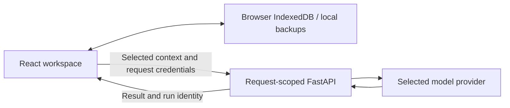

# Braipen · novel-generator

[中文](README.md) | [English](README.en.md) | [Try Braipen](https://braipen.world)

A local-first novel writing workspace with author-controlled settings, planning, generation and review. The official frontend uses React and TypeScript; FastAPI handles request-scoped computations, including LangGraph chapter planning.

**Projects and writing-style materials live in the user's browser.** There is no cloud account or hosted project-sync service. Legacy filesystem APIs remain for local compatibility; Streamlit is retired.

## Features

- Edit settings manually or ask a text model to fill selected protagonist, supporting-character, world or conflict fields while preserving other author edits.
- Generate outlines and character cards, stream prose, edit and confirm chapters, continue writing, and retain versions.
- Generate batches of 1–10 chapters while the page stays open, with explicit recovery after interruption. Confirmed prose proceeds to summary and checks.
- Request chapter-task and scene proposals through LangGraph; author approval determines what becomes generation input. No server-side persistent checkpoints.
- Use narrative graphs, context previews, Story Delta and reviewed knowledge candidates to maintain story memory.
- Create writing-style cards manually, from project prose, or from imported prose; choose defaults per project and override them for a single generation.
- Upload and crop covers to 2:3, generate 1/2/4 candidates with five presets, use controlled edits, and retain cover versions.
- Configure text and image connections, display model lists or enter model IDs, test connections and freeze per-request configuration.
- Export complete backups and restore copies. Compatible desktop browsers can synchronize to an authorized local folder; phones and other browsers use file download/restore.
- Read chapters with typography preferences and choose the default Editorial theme, Silver or Midnight colors across responsive layouts.

## Writing-style cards and examples

Open **Settings → Writing-style library**. The story-settings panel also provides the selected project's default-card picker.

1. **Edit or import:** write rules directly, import a complete JSON card, or load TXT/Markdown as rule text. Imports create a new card rather than overwriting a matching name.
2. **Analyze this project:** choose chapters; confirmed prose is listed by default, with an explicit option to include unconfirmed drafts.
3. **Analyze imported prose:** paste or import TXT/Markdown, inspect the actual submission, then explicitly start analysis. UTF-8 and GB18030 decoding are supported.

Analysis accepts at most **20,000 characters** per request, without silent truncation or automatic batching. The result remains an editable draft. Suggested examples must be verbatim excerpts from the submitted prose and require author confirmation before inclusion.

- Each project keeps its selected card and example-set snapshot. Editing a shared card does not update projects automatically; apply a newer version explicitly.
- Single-chapter choices are project default, no card, or another card. They do not change the project default. Without a card, the original short style description applies.
- Retrieval stays inside the selected card, using local scene, viewpoint and pacing tags. At most **three complete excerpts totaling 2,000 characters** are submitted. No vector database or extra embedding calls.
- Batches freeze their style pool at startup. Continuations, retries and saved interrupted drafts preserve the actual style context, including an explicit disabled choice. Chapters expose the card revision and selected examples.
- Style references control expression; their characters and events do not become story facts. Actual model fidelity still needs author evaluation.

## Connections and covers

Text presets include DeepSeek, Qwen, Kimi, GLM, OpenAI, Gemini, Claude and OpenRouter, plus Custom. Supported protocols are OpenAI Chat Completions and Anthropic Messages; model capabilities depend on the selected connection.

Image connections are configured separately. Cover generation combines a backend-maintained preset with explicit character appearance details, asks a text model to prepare the description, then calls an image model. The client exposes preset, count and controlled edit choices, without an internal image-prompt editor. Presets are cinematic realism, Chinese ink, light-novel illustration, fantasy realism and minimal symbolism.

The official Gemini image preset uses Interactions. A configured Seedream connection can be offered as an explicitly confirmed fallback. Text access or a free tier does not prove image quota is available; refusals, unknown outcomes and partial success do not trigger silent fallback or automatic regeneration.

## Local data and API keys



- Projects, prose, style cards, examples, graphs and run records stay in IndexedDB. Browser, device, domain and port changes create distinct local data spaces.
- Keys default to the current tab session. Explicitly opting into remembering a key stores it **in plaintext in the local browser**, independently of project data. Someone with access to that browser profile may read it.
- Old encrypted records support a one-time migration using the old passphrase; new encrypted records and routine unlock prompts are no longer created.
- Keys are excluded from project data, card exports, complete backups and folder-sync files. Restored connections need credentials configured again.
- The backend temporarily processes selected context and credentials for a request without persisting user projects or keys. The chosen cloud model provider still receives the submitted material.
- Download an independent backup before changing devices or clearing site data. Browser persistence and folder writing do not replace backups.

Complete backups use **`braipen-backup` v4 JSON**, including projects, the style library, cover media and credential-free connection descriptors. Readers accept v1–v3. Restore creates copies and remaps identifiers without overwriting existing projects.

Single cards use **`braipen-style-card` v1 JSON**. Desktop folder sync retains `braipen-workspace.json` and accepts existing v3/v4 files. Unfinished novel-import drafts are not part of complete project backups. Older clients cannot restore v4 backups; retain suitable backups and current data copies before rolling back.

## Run locally

Use Python **3.10+** and Node.js satisfying the pinned Vite engine requirement (`^20.19.0 || >=22.12.0`). Keep `requirements*.txt` and `frontend/package-lock.json`; use npm for this frontend.

```powershell
# Repository root
python -m venv .venv
.\.venv\Scripts\python.exe -m pip install -r requirements.txt
cd frontend
npm ci
```

Start two terminals:

```powershell
# Terminal 1: repository root
.\.venv\Scripts\python.exe -m uvicorn api.main:app --host 127.0.0.1 --port 8000
```

```powershell
# Terminal 2: frontend/
npm run dev -- --host 127.0.0.1 --port 5173
```

Open [the local workspace](http://127.0.0.1:5173) and configure connections and keys in the UI. Browser-local mode does not require user credentials in a server `.env`. On Windows with an existing environment, `start-react.bat` starts both services; `start.bat` is only a compatibility entry. Use the virtual environment's `bin/python` on Linux/macOS.

## Development and verification

Key modules:

```text
frontend/src/localStore.ts          Local transactions, style library, backups
frontend/src/localWorkflow.ts       Chapters, continuation, batches, recovery
frontend/src/writingStyle.ts        Style validation, import/export, retrieval
services/compute_service.py         Stateless computations
services/writing_style_service.py   Style extraction and context boundaries
services/chapter_planning_service.py Request-scoped chapter planning
api/routers/compute.py              JSON/NDJSON and capabilities
```

```powershell
# Repository root; providers are mocked
.\.venv\Scripts\python.exe -m unittest tests.test_writing_style tests.test_compute_api tests.test_compute_reliability -q

# frontend/
node --test scripts/test-writing-style.mjs scripts/test-writing-style-workflow.mjs
npm run build
```

For browser integration without external model calls, run `node scripts/writing-style-browser-server.mjs` from `frontend/`, open `http://127.0.0.1:5177/__writing-style-test`, and run the checks. It binds locally and handles every compute request in a mock; stop the process afterward.

Full backend discovery uses `python -m unittest discover -s tests -q`. Legacy filesystem API tests require `BRAIPEN_PUBLIC_MODE=0` only in the test process. Production stays in public mode. Current Windows validation covers all 478 backend tests in passing partitions, 196 frontend checks and 17 browser integration checks. Short deadline tests have shown timing instability in a single-process full run; report that separately from partition results.

## Self-hosting boundaries

Serve the built frontend with same-origin `/api/compute/*`. **`BRAIPEN_PUBLIC_MODE=1` is the default**: health, capabilities and compute routes are exposed; legacy shared project/settings routes and OpenAPI are blocked.

- Keep one worker while admission and model concurrency limits remain process-local.
- Custom execution requires administrator-configured `BRAIPEN_SELF_ADDRESSES`; retain DNS/IP pinning, destination checks and redirect restrictions.
- Preserve streaming through the reverse proxy and disable request/response disk buffering and site request logs.
- Update frontend and backend together for writing-style support. An older backend is explicitly rejected for style-dependent generation.
- Validate a candidate release, retain rollback configuration, then switch versions. Real model calls need their own provider, budget and material scope.

Legacy file mode is local-only: explicitly set `BRAIPEN_PUBLIC_MODE=0`, use `.env.example` and a private `.env`, and retain generated files under `workspace/books/{book_id}/`; older `outputs/` projects remain compatible. Do not expose that compatibility mode as a shared public service.

## Further validation

Compare short style descriptions, style cards, fixed examples and retrieved examples using author-approved material, the same model and the same chapter task. Evaluate naturalness, character voices, imported plot facts and copying. Mock checks do not establish real writing-quality improvements or physical-phone usability.

[Frontend development](frontend/README.md) · [Prompt-design reference](docs/prompt_design.md) · [Project handover](HANDOVER.md)
