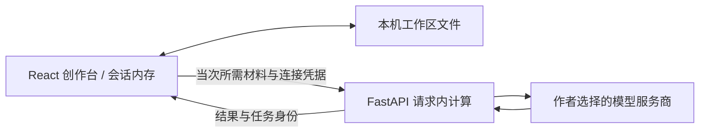

# Braipen · novel-generator

[中文](README.md) | [English](README.en.md) | [在线体验](https://braipen.world)

一个由作者掌握方向的 AI 小说创作台：设定、规划、生成、确认与审核各有依据。正式前端为 React + TypeScript，后端为 FastAPI；章节策划使用请求内 LangGraph。

**创作资料保存在用户选择的本机工作区文件，页面只保留本次内存工作副本，服务器只处理当次计算。** 浏览器仅保留模型连接、Key 和界面偏好，没有云端账号或小说项目同步服务。旧文件项目接口保留作本机兼容，Streamlit 已退役。

## 当前功能

| 能力 | 使用方式 |
| --- | --- |
| 故事设定 | 手动填写，或选择主角、配角、世界观、核心冲突中的空缺/指定项，由文本模型补充；生成前保留未保存的手写内容。 |
| 大纲与人物卡 | 根据设定生成，也可手动编写和修改。未提交编辑随工作区保留；保存前核对资料版本，正文生成会结合前文、摘要与批准的规划。 |
| 章节创作 | 流式生成、编辑确认、续写与版本保留；确认后生成摘要与检查。连续生成每批 1–10 章，需要保持页面打开，中断后可手动恢复。 |
| 章节规划 | LangGraph 在当次请求内生成任务单和场景候选；作者批准后才成为生成依据，不使用服务器持久化检查点。 |
| 故事记忆 | 叙事图谱、上下文预览、Story Delta 和待审核知识；候选知识经作者接受后进入正式记忆。 |
| 文风卡与范例 | 手写/导入、分析本项目正文、分析外部正文三种入口；项目独立选卡，单章可临时换卡或禁用。 |
| 小说封面 | 本地上传与固定 2:3 框选；模型生成 1/2/4 张，五种预设风格、受控修改与版本选择。 |
| 模型连接 | 八类文本服务商预设与 Custom，模型目录展示与手填、连接检测、请求级配置及凭据。 |
| 本机工作区 | 打开文件夹后自动写入一个工作区文件；每次打开页面需重新选择。手机及其他浏览器使用打开文件与下载。旧浏览器创作资料可迁移，清理需用户明确确认。 |
| 阅读与外观 | 章节阅读、排版偏好，铅印为默认主题，银灰和午夜可选，适配桌面与手机宽度。 |

## 文风卡怎么使用

打开 **偏好设置 → 文风库**。也可以从 **创作台 → 故事设定 → 文风卡** 选择当前作品的默认卡。

1. **直接编辑或导入**：填写名称与文风规则；JSON 导入完整卡和范例，TXT/Markdown 可直接作为规则草稿导入。导入会创建新卡，不覆盖同名卡。
2. **根据当前项目生成**：选择一章，默认只列已确认正文，也可主动显示未确认正文。在预览框中调整实际分析范围。
3. **根据导入文本生成**：粘贴或导入 TXT/Markdown 正文，再点击“提取文风卡”。正文支持 UTF-8、GB18030 解码。

正文最多 **20,000 字符**，包含标点、空格和英文字母；超过上限在模型调用前报错，不截断、不采样。一次点击执行一个最多五轮的提取任务，依次整理整体文风、语言段落、对白节奏、完整卡和原文核对。每轮输出额度为 **20,000 个令牌**，规则仍最多 **6,000 字符**。中途失败不自动重试，最近有效草稿保留；不支持该额度的模型不会自动降额或切换。

结果先进入可编辑草稿，不评分或自动应用。候选范例必须能在所选原文中逐字找到，并由作者明确收录和保存。五轮功能需要前后端共同更新。

- 项目保存选定卡及范例集的快照。共用卡修改后，项目保留原版，点击“更新到新版”才切换。
- 单章可选“跟随项目”“不使用文风卡”或另一张卡，不修改项目默认。未选卡时沿用原有风格短描述。
- 范例限定在所选卡中，按场景、人称和节奏做本地标签匹配，每次最多 **3 段、总计 2,000 字符**。没有向量数据库或额外 Embedding 调用。
- 连续生成固定启动时的文风池；续写、重试和中断草稿保留实际使用的上下文，章节可查看文风版本及范例。
- 文风规则只控制表达，范例中的人物与剧情不能成为本书事实。生成效果仍需要作者判断；模拟测试不代表真实文风质量。

## 模型连接与封面

在 **偏好设置 → 模型连接** 配置文本服务。预设包括 DeepSeek、Qwen、Kimi、GLM、OpenAI、Gemini、Claude、OpenRouter，另有 Custom。协议支持 OpenAI Chat Completions 与 Anthropic Messages；实际模型能力以所选连接为准。

图片服务在“图片模型连接”中独立配置。封面生成把后端维护的预设风格与人物卡中可识别的外观描述交给文本模型整理，再调用图片模型；页面不提供内部生图指令的查看与改写入口。五种风格为电影写实、国风水墨、轻小说插画、幻想写实、极简象征。

官方 Gemini 图片路径使用 Interactions；Seedream 可作为显式确认的兜底。免费层级、模型目录或文本可用，不代表图片额度可用。内容拒绝、未知结果或已保存部分图片的失败不会自动触发兜底或重复调用。

## 数据保存与 API Key



- 项目、正文、文风卡、范例、图谱、封面和创作草稿不再写入浏览器数据库。桌面 Chrome/Edge 在“偏好设置 → 本地数据与体验”打开文件夹；写入并回读成功才显示已保存。刷新后需重新打开工作区。
- 旧浏览器创作资料只有显式迁移时才读取；迁移写盘校验成功后，用户可单独清理旧记录，Key 和偏好保留。文件写入失败时保留草稿并提供下载，不改存浏览器。
- 写入失败时，普通工作区下载包含待保存的新内容；“重试保存”成功后才提交新版本。待重试期间暂停其他正式写入，避免覆盖失败稿。任务单、场景计划和策划意图的未提交编辑也包含在工作区中。
- 创作请求准备、执行及取消清理期间不能切换工作区；沿用各请求已有超时，清理完成后才解除限制。重新打开文件时，遗留的运行中任务显示为中断或结果未知，不会自动重试。
- Key 默认仅当前标签页使用。主动勾选“在此浏览器记住 API Key”后，Key **以明文独立保存在本地浏览器**，不需要日常口令。能访问此浏览器资料的人可能读取它。
- 旧版加密 Key 只保留一次性迁移，迁移时才需要旧口令；不再创建新的加密记录。
- Key 不进入项目正文、文风卡导出、完整项目备份或文件夹同步文件。恢复连接后需要重新配置 Key。
- 后端请求内暂时处理材料与凭据，不持久化用户项目或 Key；云端模型服务商仍会收到本次提交的内容。
- 不支持直接访问文件夹时，手动打开或下载工作区；下载发起不代表文件已经落盘，请确认本机文件完整后再关闭页面。

### 备份格式与兼容

完整备份统一写为 **`braipen-backup` v5 JSON**，包含项目、文风库、封面媒体、导入及编辑草稿与不含 Key 的连接描述，读取兼容 v1–v4。打开工作区保留项目标识和修订，不重复创建副本。旧的备份副本恢复接口仍保留兼容，含草稿的 v5 文件需通过打开工作区完整载入。

单卡使用 **`braipen-style-card` v1 JSON**。桌面文件夹保存为 `braipen-workspace.json`，兼容旧工作区。目录句柄仅本次页面使用，不写浏览器。

旧客户端不支持 v5 工作区。计划回滚应用前，请保留旧版备份和当前数据副本。

## 本地运行

需要 Python **3.10 或更高版本**，以及满足锁定 Vite 引擎要求的 Node.js（`^20.19.0 || >=22.12.0`）。沿用 `requirements*.txt` 和 `frontend/package-lock.json`，不混用包管理器。

在仓库根目录创建环境：

```powershell
python -m venv .venv
.\.venv\Scripts\python.exe -m pip install -r requirements.txt
cd frontend
npm ci
```

分别在两个终端启动：

```powershell
# 终端一：仓库根目录
.\.venv\Scripts\python.exe -m uvicorn api.main:app --host 127.0.0.1 --port 8000
```

```powershell
# 终端二：frontend 目录
npm run dev -- --host 127.0.0.1 --port 5173
```

打开 [本地创作台](http://127.0.0.1:5173)，在网页内配置连接和 Key。浏览器本地模式不需要把用户 Key 写入服务器 `.env`。已有环境的 Windows 用户也可运行 `start-react.bat`；`start.bat` 仅作兼容入口。Linux/macOS 使用虚拟环境对应的 `bin/python`。

## 开发与验证

核心入口：

```text
frontend/src/localStore.ts       内存创作事务、工作区v5与旧库迁移
frontend/src/localWorkflow.ts    章节确认、续写、批次及任务恢复
frontend/src/writingStyle.ts     文风卡校验、导入导出、范例选择
services/compute_service.py      无状态计算操作
services/writing_style_service.py 文风提取与上下文边界
services/chapter_planning_service.py 请求内章节策划
api/routers/compute.py           JSON / NDJSON 与能力接口
```

```powershell
# 仓库根目录：公共计算及文风相关测试，模型使用 mock
.\.venv\Scripts\python.exe -m unittest tests.test_writing_style tests.test_style_distillation tests.test_compute_api tests.test_compute_reliability -q

# frontend 目录：文风数据与工作流测试、生产构建
npm test
node --test scripts/test-writing-style.mjs scripts/test-writing-style-workflow.mjs scripts/test-file-workspace.mjs scripts/test-style-distillation.mjs scripts/test-local-folder-sync.mjs
npm run build
```

无外部模型调用的浏览器集成夹具：在 `frontend` 目录运行 `node scripts/writing-style-browser-server.mjs`，打开 `http://127.0.0.1:5177/__writing-style-test` 并点击运行验收。它只在本机监听，全部计算请求由模拟器处理；结束后停止该进程。

完整后端发现命令为 `python -m unittest discover -s tests -q`。旧文件接口测试需要仅在测试进程设置 `BRAIPEN_PUBLIC_MODE=0`；生产保持公共模式。本机文件 MVP 的验收包含483项后端全套测试、203项前端单元检查和8项浏览器集成场景。浏览器使用模拟目录句柄与模型，真实目录授权及模型效果需实际使用验证。

## 自托管边界

生产前端构建后通过同源 `/api/compute/*` 访问后端。默认 **`BRAIPEN_PUBLIC_MODE=1`**：公开健康、能力及计算接口，阻止旧文件项目、共享设置和 OpenAPI 路径。

- 保持单 worker；当前入站容量与模型并发配额是进程内的。
- Custom 需要管理员配置 `BRAIPEN_SELF_ADDRESSES`，排除服务自身地址；不能省略现有 DNS/IP、重定向与目的地验证。
- 反向代理应保留流式响应、关闭请求/响应磁盘缓冲与站点请求日志，不能依靠前端隐藏来保护数据。
- 文风功能需要前后端共同更新；旧后端没有文风能力时，界面会阻止选卡生成，不静默忽略。
- 正式发布先验证候选，再切换版本并保留回滚配置。真实模型调用应单独明确服务、预算和材料。

旧文件模式仅供本机兼容：显式设置 `BRAIPEN_PUBLIC_MODE=0`，使用 `.env.example` 和本地 `.env`，生成资料位于 `workspace/books/{book_id}/`，历史 `outputs/` 项目继续兼容。该模式不应开放为共享公网服务。

## 后续验证

使用作者确认的真实材料，在相同模型和章节任务下比较基础风格描述、文风卡、固定范例、检索范例，评价自然度、角色差异、剧情串入与照搬率。真实文风收益和物理手机体验尚未由模拟验收证明。

[前端开发说明](frontend/README.md) · [提示词设计参考](docs/prompt_design.md) · [项目交接](HANDOVER.md)
